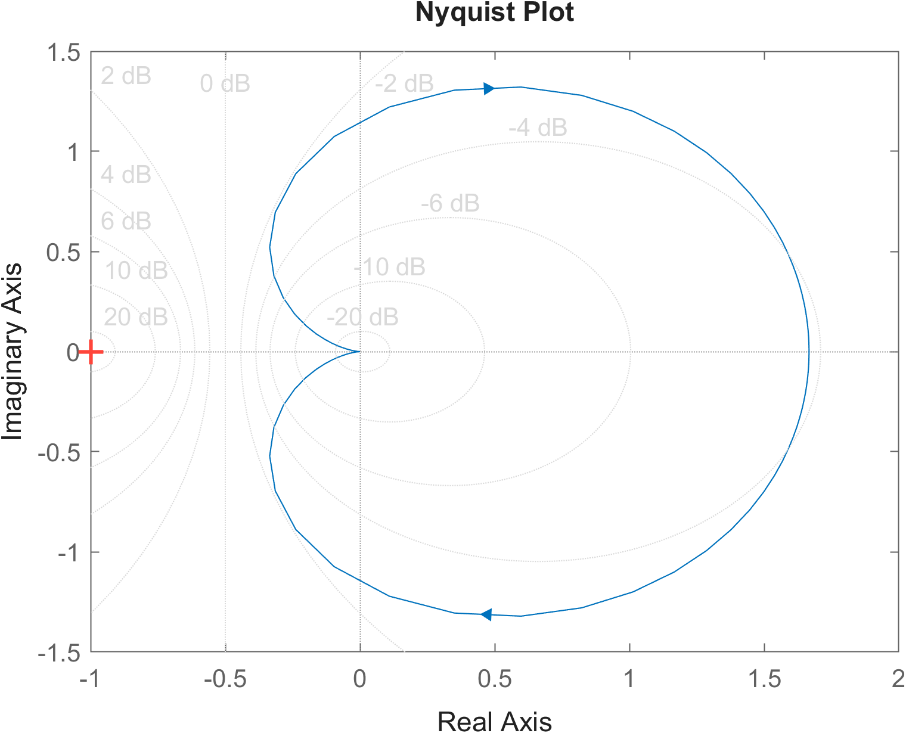
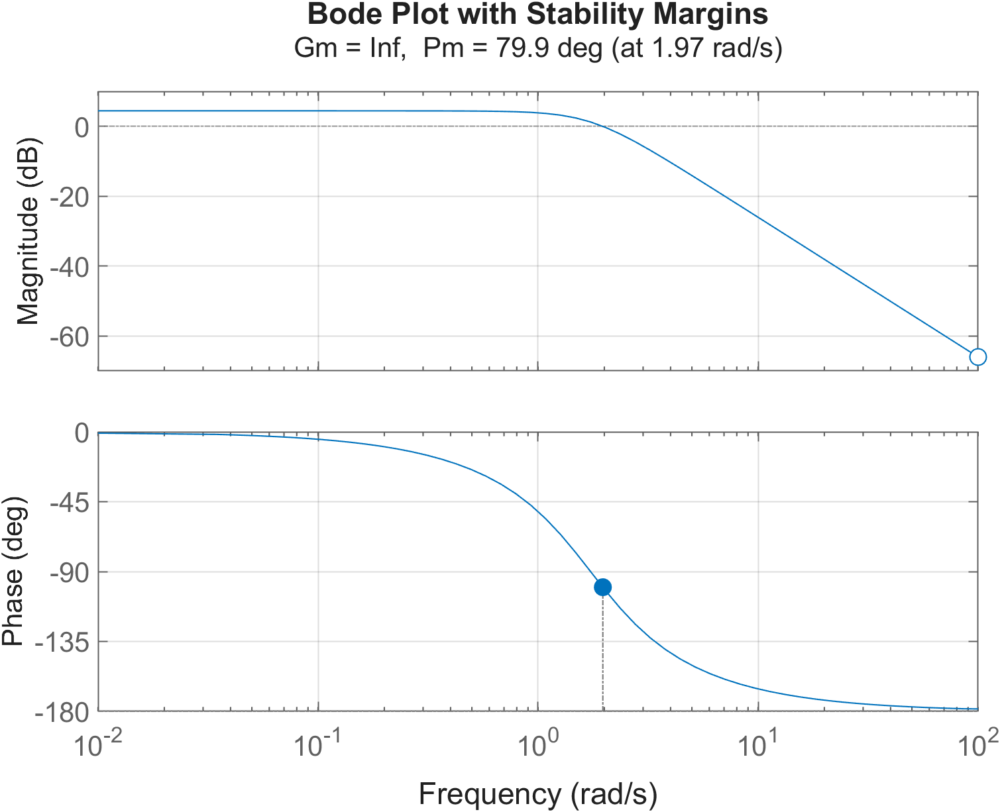
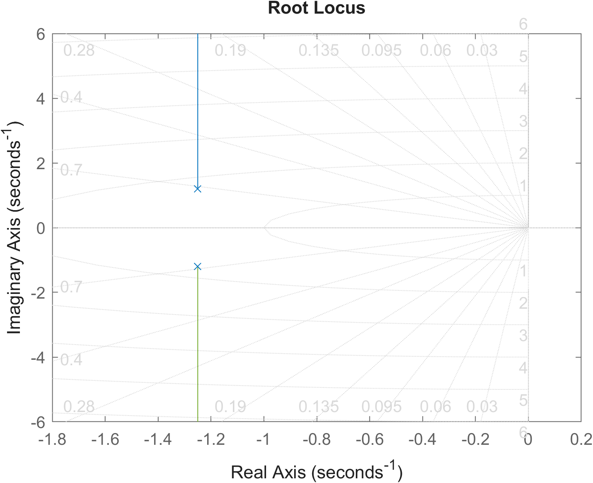
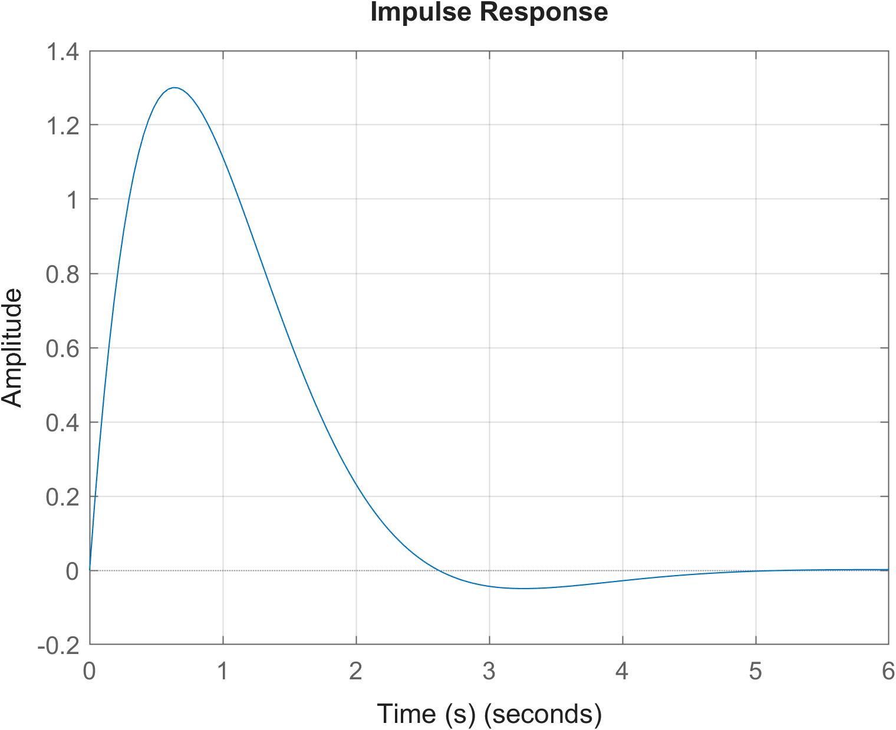
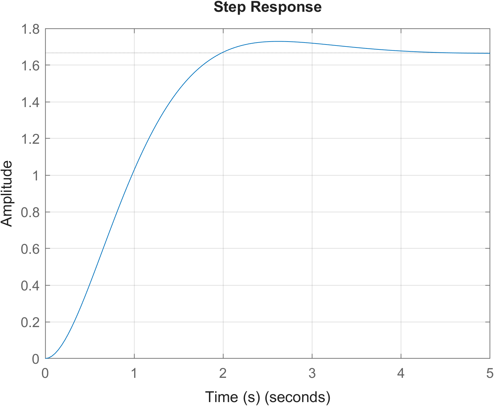
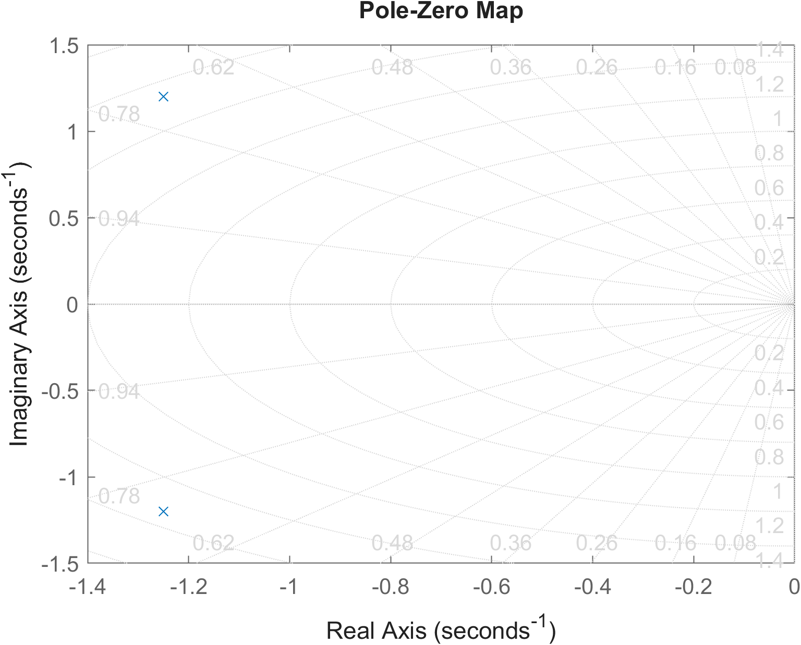

# MATLAB Control System Analysis & Stability Toolbox

A MATLAB-based toolbox for the analysis, performance evaluation, and stability assessment of continuous-time Linear Time-Invariant (LTI) control systems.

Developed as an academic engineering project to explore classical control-system analysis techniques through MATLAB and Control System Toolbox.

**Developer:** Kaif Ahmad Khan  
**Language:** MATLAB  
**Domain:** Control Systems | Stability Analysis | System Dynamics

---

## Overview

The Control System Analysis & Stability Toolbox accepts the numerator and denominator coefficients of a transfer function and performs a range of time-domain, frequency-domain, and stability analyses.

It generates graphical visualizations and numerical results, followed by an automated HTML analysis report.

## Key Features

- **Transfer Function Modelling:** Constructs continuous-time transfer functions from user-defined polynomial coefficients.
- **Pole-Zero Analysis:** Calculates system poles and zeros and generates a pole-zero map.
- **Time-Domain Analysis:** Evaluates step and impulse responses and extracts performance parameters.
- **Stability Analysis:** Examines pole locations and evaluates system stability.
- **Routh-Hurwitz Criterion:** Constructs the Routh array and checks stability using sign changes.
- **Root Locus Analysis:** Visualizes the movement of closed-loop poles as gain varies.
- **Frequency-Domain Analysis:** Generates Bode plots and calculates gain margin and phase margin.
- **Nyquist Analysis:** Generates the Nyquist plot for frequency-domain stability investigation.
- **Automated System Assessment:** Summarizes key stability and performance indicators.
- **HTML Report Generation:** Automatically generates a report containing numerical results, stability assessment, and graphical outputs.

## Graphical Outputs

### 1. Nyquist Plot


### 2. Bode Plot


### 3. Root Locus


### 4. Impulse Response


### 5. Step Response


### 6. Pole-Zero Map


## Technologies & Requirements

- MATLAB R2024b (developed and tested environment)
- Control System Toolbox

The project uses MATLAB functions for transfer-function modelling, time-response analysis, frequency-response analysis, and graphical visualization.

## How to Run

1. Clone or download this repository.
2. Open MATLAB.
3. Set the repository directory as the Current Folder.
4. Ensure the project files are accessible from the MATLAB path.
5. Run `main.m`.

The program prompts the user to enter numerator and denominator coefficients.

**Example input:**

Numerator:
```matlab
10
```

Denominator:
```matlab
[2 5 7]
```

This represents:

\[
G(s)=\frac{10}{2s^2+5s+7}
\]

The toolbox then performs the available analyses and generates plots and an HTML report.

## Project Structure

The repository contains the following MATLAB modules:

| File | Purpose |
|---|---|
| `main.m` | Main execution script |
| `validate_system.m` | Validates transfer-function input |
| `transfer_function.m` | Constructs the transfer function |
| `pole_zero_analysis.m` | Pole-zero calculations and plotting |
| `time_response.m` | Step and impulse response analysis |
| `stability_analysis.m` | Pole-based stability assessment |
| `routh_hurwitz.m` | Routh-Hurwitz stability criterion |
| `root_locus_analysis.m` | Root locus visualization |
| `frequency_analysis.m` | Bode plot and stability margins |
| `nyquist_analysis.m` | Nyquist plot generation |
| `system_health.m` | Consolidated system assessment |
| `system_assessment.m` | System assessment module |
| `generate_report.m` | Automated HTML report generation |

## Automated Analysis Report

The toolbox generates an HTML report containing:

- Transfer-function information
- Pole and zero locations
- Routh-Hurwitz array
- Time-domain performance parameters
- Gain margin and phase margin
- Stability assessment
- Graphical analysis outputs

[View the generated HTML analysis report](Control_System_Analysis_Report.html)

## Learning Outcomes

This project provides practical implementation experience in:

- Classical control-system analysis
- Mathematical modelling of LTI systems
- Time-domain and frequency-domain techniques
- Stability criteria and pole-zero interpretation
- MATLAB programming and modular software development
- Automated technical reporting

## Future Improvements

- Interactive MATLAB App Designer interface
- Support for additional system models
- Improved numerical validation and special-case handling
- Expanded stability and robustness analysis

---

**Author:** Kaif Ahmad Khan  
**Project:** Control System Analysis & Stability Toolbox  
**Repository:** [GitHub](https://github.com/mekaifkhan/Control-System-Analysis-Toolbox)
